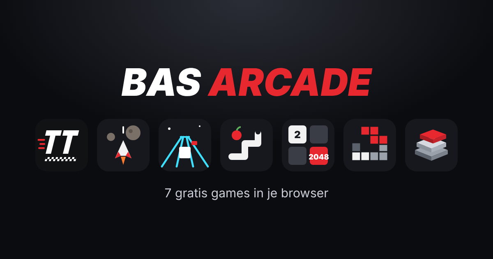

# 🎮 Bas Arcade

Gratis browsergames die je meteen kunt spelen, op pc en op je telefoon.

**Spelen:** https://basjonker2009-lab.github.io/Game/

| Game | Map | Wat is het? |
|---|---|---|
| 🏁 **Turbo Tijdrit** | `race/` | 3D-racegame tegen de klok: 12 levels met loopings, schansen en muurritten, medailles en een spookauto |
| ☄️ **Meteorenregen 2.0** | `meteoren/` | Schiet meteoren en vijanden kapot. Je kanon raakt oververhit, het tempo gaat steeds omhoog en elke minuut komt er een baas |
| 🏃 **Neon Runner** | `runner/` | 3-baans endless runner: springen, bukken en munten pakken in een neonwereld |
| 🐍 **Snake 2.0** | `snake/` | Snake met gouden appels, power-ups en levels met muren |
| 🔢 **2048** | `2048/` | Schuif tegels en combineer tot 2048 (met terug-knop) |
| 🧱 **Blokken** | `blokken/` | Vallende blokken met vooruitblik, bewaren en een schaduwblok |
| 🗼 **Stack Tower** | `stack/` | Stapel blokken precies op elkaar |

Elke game is één `index.html` zonder extra libraries. Records worden in je browser bewaard en op de startpagina getoond.
