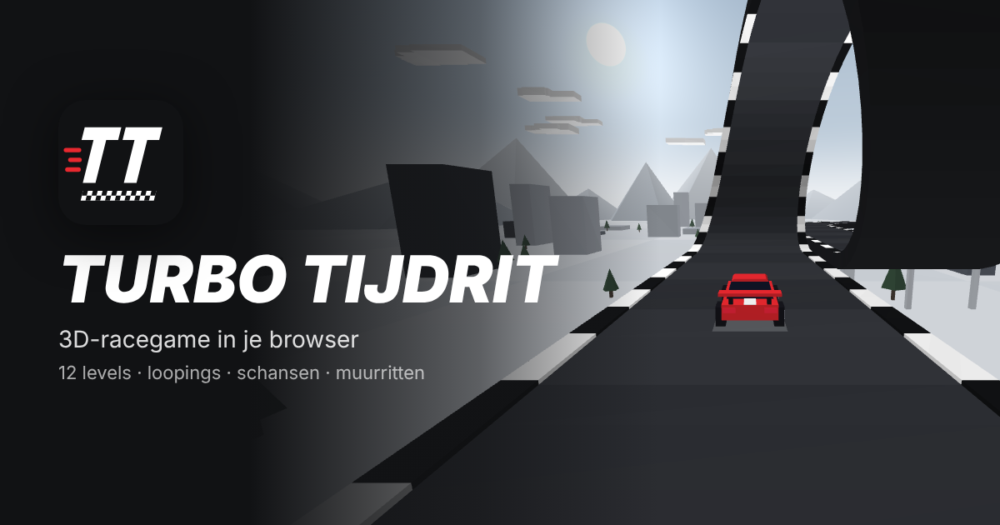

# 🏁 Turbo Tijdrit

Een 3D-racegame in je browser, geïnspireerd op PolyTrack, in een strakke wit-zwart-grijze stijl. Race tegen de klok over zwevende banen met loopings, schuine bochten, muurritten, schansen, boosts en smalle stukken.

**Spelen:** https://basjonker2009-lab.github.io/Game/

## Levels

| # | Level | Wat je krijgt |
|---|---|---|
| 1 | Eerste Rit | Rustig beginnen |
| 2 | Springplank | Schansen over een gat |
| 3 | Looping | Drie loopings: genoeg snelheid of je valt eraf |
| 4 | Schuine Bochten | Gekantelde bochten |
| 5 | Bultenweg | Bulten waar je overheen vliegt |
| 6 | Boostbaan | Boosts en grote sprongen |
| 7 | Muurrit | Bijna verticaal over de muur rijden |
| 8 | Smalle Paden | Smalle stukken weg |
| 9 | Achtbaan | Loopings en heuvels |
| 10 | Slingerweg | Bocht na bocht |
| 11 | Wolkenkrabber | Hoog klimmen, muren en een looping |
| 12 | Meesterwerk | Alles tegelijk |

Haal een level om het volgende vrij te spelen. Per level zijn er medailles te verdienen: 🥇 goud, 🥈 zilver en 🥉 brons.

## Besturing

| Actie | Toetsenbord |
|---|---|
| Gas / rem | ↑ ↓ of W S |
| Sturen | ← → of A D |
| Driften | Spatie |
| Opnieuw beginnen | R |
| Terug naar laatste checkpoint | Enter |
| Pauze | Esc of P |
| Geluid aan/uit | M |

Op je telefoon verschijnen knoppen op het scherm.

## Extra's

- De tijd start pas als je gas geeft.
- **Spookauto**: je racet tegen een doorzichtige auto van je beste rit.
- Bij elk checkpoint zie je of je voor (groen) of achter (rood) ligt op je record.
- Kies in het menu de kleur van je auto.
- Je records en medailles worden in je browser bewaard.

De hele game zit in `index.html`, zonder extra libraries. Daarnaast zijn er een icoontje (`icon.svg` en PNG's), een deelplaatje (`og-image.png`) en een `manifest.webmanifest`, zodat je de game op je telefoon aan je beginscherm kunt toevoegen.
