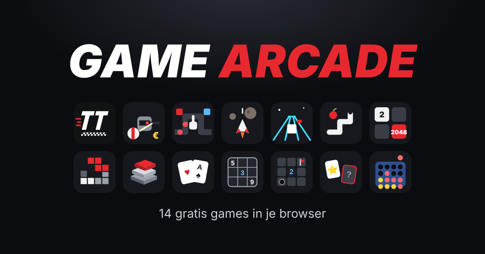

# 🎮 Game Arcade

Gratis browsergames die je meteen kunt spelen, op pc en op je telefoon.

**Spelen:** https://basssie91.github.io/Game/

## Games

| Game | Map | Wat is het? |
|---|---|---|
| 🏁 **Turbo Tijdrit** | `race/` | 3D-racegame tegen de klok: 20 levels met loopings, haarspeldbochten, megaschansen, muurritten, obstakels en gaten in de weg, medailles en een spookauto |
| 🏀 **Basket Koning** | `basket/` | Basketbal: tijdrace met de krachtmeter, een toernooi of 1 tegen 1 met dunks, blocks en afpakken (ook tegen een vriend) |
| ⚽ **Penalty Koning** | `penalty/` | Houd spatie vast, het mikpunt zigzagt over het doel: laat los en schiet. Keep zelf ook en win het toernooi |
| 🕵️ **Nachtdief** | `dief/` | Sluip door 12 gebouwen, ontwijk bewakers, camera's en lasers, kraak de kluis en ontsnap |
| 🎱 **Pool** | `pool/` | 8-ball met powerups tegen de bot of een vriend: win het toernooi van 8 rondes |
| 🥅 **Puck Voetbal** | `voetbal/` | Voetbal van bovenaf: schiet je schijven tegen de bal, kies een powerup en win het toernooi |
| 🔐 **Escape Room** | `escape/` | 10 moeilijke 3D-kamers vol codes, sloten en puzzels: ontsnap zo snel mogelijk |
| 🖥️ **PC Tycoon** | `tycoon/` | Run je eigen pc-winkel: vul de schappen, reken af en bouw steeds grotere winkels |
| 🗼 **Robo Defense** | `td/` | Tower defense: torens bouwen en upgraden tegen golven robots op 9 kaarten, vanaf kaart 4 met Herstellers, Spookrobots, Storers en Titans. Je potje wordt opgeslagen, dus je kunt later verder |
| ☄️ **Meteorenregen 2.0** | `meteoren/` | Schiet meteoren en vijanden kapot. Je kanon raakt oververhit en elke minuut komt er een baas |
| 🏃 **Neon Runner** | `runner/` | 3-baans endless runner: springen, bukken en munten pakken in een neonwereld |
| 🐍 **Snake 2.0** | `snake/` | Snake met gouden appels, power-ups en levels met muren |
| 🔢 **2048** | `2048/` | Schuif tegels en combineer tot 2048 (met terug-knop) |
| 🧱 **Stack Tower** | `stack/` | Stapel blokken precies op elkaar |
| 🧗 **Toren Klimmer** | `klimmer/` | Platformer: klim zo hoog mogelijk terwijl de lava stijgt. Dubbele sprong, muursprong, bewegende en brokkelende platforms, veren en lasers. Elke dag een nieuwe dagtoren met een eigen dagranglijst |

## Wat zit er nog meer in?

- **Inloggen:** je records en voortgang worden in je account bewaard, zodat je op elk apparaat verder kunt spelen. Zonder account kun je je records ook overzetten met een code.
- **Ranglijst:** de beste spelers per game. De Discord-bot leest dezelfde ranglijst.
- **Recordkaart:** na een potje of level zie je bovenin of jij het record van iedereen hebt, of wie het heeft en hoeveel je nog te gaan hebt.
- **Favorieten:** zet met de ★ je lievelingsgames bovenaan het startscherm.
- **Verder spelen:** je laatst gespeelde games staan bovenaan.
- **Suggestiebord:** iedereen kan de ideeën lezen, ingelogde spelers kunnen er zelf een insturen en met 👍 stemmen op andermans ideeën (sorteren op Nieuwste of Populairste).
- **🎁 Nieuw-knop:** bovenaan het startscherm, met alle updates (de nieuwste bovenaan). Nieuwe updates zet je bovenaan het `log` in `version.json`.
- **Updatemelding:** komt er een nieuwe versie online, dan krijg je een melding met wat er nieuw is.
- **Admin** (`admin/`): mededelingen plaatsen en de ranglijst beheren. Suggesties beheert de admin op het startscherm.

## Techniek

Elke game is één `index.html` zonder build-stap. De 3D-games gebruiken three.js uit `lib/`. Inloggen, de ranglijst en het suggestiebord draaien op Firebase (`auth.js`). Bij elke update krijgen `version.json` en de `site-build`-tag in alle pagina's een nieuwe code, zodat spelers de updatemelding zien.
